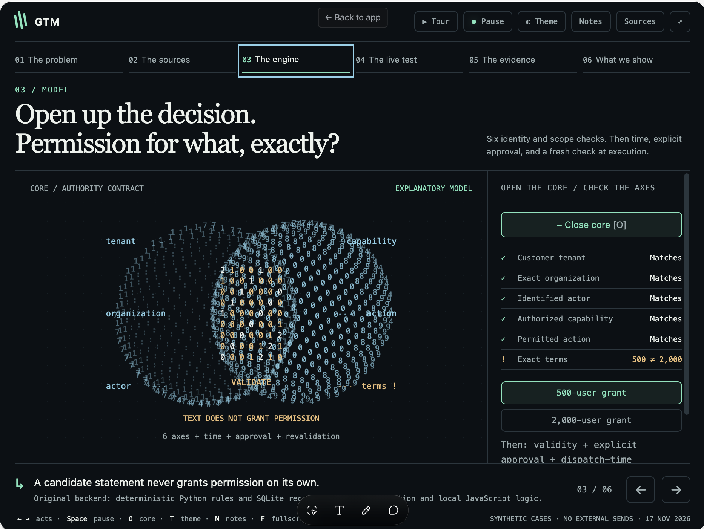
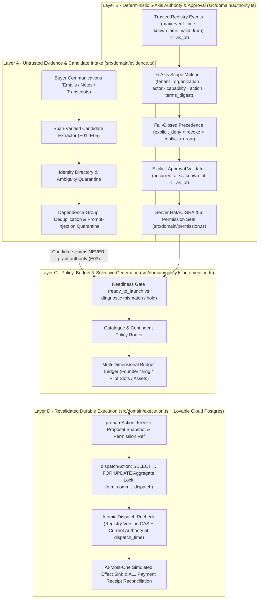

<div align="center">

# GTM Buying Decision Discovery Engine

**From _"Looks Approved"_ to Verifiable, Scoped Commercial Action**

[](https://www.typescriptlang.org/)
[](https://tanstack.com/start)
[](https://lovable.dev)
[](./docs/rebuild-status.md)
[-16A34A)](./docs/parity-report.md)
[](./src/evaluation/metamorphic.ts)
[](./src/domain/field.ts)

<br />



*Six-Act Interactive Presentation (`/presentation`, Act 03): Opening the deterministic authority core to inspect exact six-axis scope matching (`500-seat pilot` vs `2,000-seat annual rollout`), temporal visibility, explicit approval, and dispatch-time revalidation.*

</div>

---

## 1. Executive Overview

In enterprise Go-To-Market (GTM) execution, sales teams and AI agents routinely mistake **surface conversational intent** (*"Yes, we can proceed with Cloudflare Access"*) for **verifiable buying authority**. Acting on unverified or mismatched scope causes two failure modes:

1. **Scope & Entity Traps (`CF-01A` vs `CF-01B`):** A buyer says *"approved to proceed"* while the request targets a **2,000-seat annual expansion (`$240,000`)**, yet the underlying governance grant and explicit approval only authorize a **500-seat pilot** (or a subsidiary entity, or a technical sandbox rather than commercial spend).
2. **Temporal Revocation Between Decision and Dispatch (`CF-02A` vs `CF-02B`):** Authorization is genuinely valid when the proposal is prepared (`t = 100`), but a revocation (`revision 2`) becomes visible at `t = 105` before execution at `t = 110`. Without atomic dispatch-time revalidation, stale intents leak unauthorized commercial side effects.

**GTM Buying Decision Discovery Engine** places a deterministic verification, policy, and transactional execution boundary between buyer communications and consequential GTM actions.

> **Data Provenance & Honesty Boundary:** Cloudflare Access is used solely as public product context. All buyer communications, directories, authority grants, timelines, and payments in this repository are **synthetic** (`0/20` real commercial observations; field pilot gate remains in `HOLD_OBSERVATION_RESOLVE_CAUSE`).

---

## 2. System Architecture

The engine enforces strict separation between untrusted communication extraction, server-sealed authority resolution, transactional execution, and evaluator-only gold labels.



### Six-Axis Authority Contract (`Key`)

Every authority grant, explicit approval, and frozen execution intent is bound to an exact six-tuple:

| Axis | Key Field | Failure Reason Code on Mismatch | Description |
| :--- | :--- | :--- | :--- |
| **1. Tenant** | `tenant` | `scope_mismatch_tenant` | Strict multi-tenant isolation boundary (`E07`) |
| **2. Organization** | `organization` | `scope_mismatch_organization` | Legal entity boundary (blocks subsidiary-to-parent escalation) |
| **3. Actor** | `actor` | `scope_mismatch_actor` | Verified directory actor ID (`ambiguous_actor_identity` blocks launch) |
| **4. Capability** | `capability` | `scope_mismatch_capability` | Technical sandbox (`run_sandbox`) vs commercial spend (`approve_spend`) |
| **5. Action** | `action` | `scope_mismatch_action` | Canonical GTM action (`standard_offer`, `isolated_pilot`, etc.) |
| **6. Terms Digest** | `terms_digest` | `scope_mismatch_terms_digest` | Exact commercial terms hash (`terms-access-500-pilot-only` ≠ `2000-seats`) |

---

## 3. Canonical Four-Case Demonstration (`/demo`)

The interactive workbench in [`src/routes/demo.tsx`](./src/routes/demo.tsx) and the six-act presentation in [`/presentation`](./src/routes/presentation.tsx) evaluate four counterfactual scenarios against Lovable Cloud Postgres:

| Case ID | Scenario & Mechanism | Decision (`t = 100`) | Dispatch (`t = 105 / 110`) | Selected Action | Simulated Effects |
| :--- | :--- | :--- | :--- | :--- | :---: |
| **`CF-01A`** | **2,000-Seat Valid Control** (`terms-access-2000-seats-annual` granted & approved) | `allowed` (`ready_to_launch`) | `committed` (`t = 105`) | `prepare_proposal_2000_users` | **`1`** |
| **`CF-01B`** | **500-Seat Scope Trap** (Request asks for 2,000 seats; grant covers `500-pilot-only`) | `unknown` (`scope_mismatch_terms_digest`) | `blocked` (`t = 105`) | `confirm_expansion_and_review_pilot_500` *(retains 500 pilot)* | **`0`** |
| **`CF-02A`** | **Valid Proposal Send** (`terms-access-proposal-send` active through `t = 200`) | `allowed` (`ready_to_launch`) | `committed` (`t = 110`) | `send_approved_proposal` | **`1`** |
| **`CF-02B`** | **Mid-Flight Revocation (`K14`)** (Prepared at `t = 100`; `rev2` revoke visible at `t = 105`) | `allowed` (`ready_to_launch`) | `blocked` (`revoked` at `t = 110`, `changed_after_event = true`) | `invalidate_send_and_confirm_new_scope` | **`0`** |

---

## 4. Benchmark, Operational & Simulation Verification

All acceptance suites execute via Vitest (**`119/119` tests passing across 12 test suites**) and Playwright browser verification:

### 4.1 Diagnostic 24-Case Counterfactual Benchmark (`/benchmark`)

Evaluates 12 minimal pairs (24 cases: 12 valid controls + 12 adversarial traps) across three executable arms without case-ID lookup tables (`Q01–Q07`):

| Comparator Arm | Valid Actions (`24`) | False Authorizations (`12` Traps) | Minimal Pairs Solved (`12`) | Metamorphic Invariance & Responsiveness |
| :--- | :---: | :---: | :---: | :---: |
| **Arm D — GTM Verified Engine** (`decideD`) | **`24 / 24` (100%)** | **`0 / 12` (0%)** | **`12 / 12` (100%)** | **`132 / 132` checks passed** |
| **Arm C — Surface-Polarity Rules** (`baselineC`) | `14 / 24` (58.3%) | `10 / 12` (83.3%) | `2 / 12` (16.7%) | Lacks 6-axis scope & dispatch recheck |
| **Arm B — Local CRM Boolean Proxy** (`proxyB`) | `13 / 24` (54.2%) | `11 / 12` (91.7%) | `1 / 12` (8.3%) | Stage/flag proxy (not a live Salesforce run) |
| **Arm A — External Product (Aligned DSR)** | `UNTESTED` | `UNTESTED` | `UNTESTED` | Explicitly unscored comparator |

### 4.2 Operational MVE v2 Trial & Field Gate (`/field` & `/evidencia`)

Reconstructs operational timing and authority resolution across 20 simulated opportunities (`F01–F07`) with explicit IANA business-hours deadlines (`48 business hours = 6 workdays`, `2 business days = 16 hours`):

- **Direct Trusted Coverage:** `16 / 20` (`80.0%`) — includes sources that prove scope is insufficient or revoked.
- **Timely Verified Coverage:** `14 / 20` (`70.0%`) — verified before both cutoff and next commercial milestone.
- **Activity vs. Resolution Bottleneck:** Among `13` cases requiring buyer contact, **`12 / 13` (`92.31%`)** had `≤ 1` request sent (activity metric), but only **`1 / 13` (`7.69%`)** achieved a valid confirmed permission before cutoff (resolution metric, below the `≥ 75%` pilot gate).
- **Median Human Effort:** `6.25 minutes` per opportunity (`≤ 10 min` target).
- **Real Commercial Cohort:** **`0 / 20`** observed (`HOLD_OBSERVATION_RESOLVE_CAUSE`).

### 4.3 Synthetic World Simulator & Research Reference (`/experiments` & `/research`)

- **Live TypeScript Simulator (`src/domain/sim/`):** Seedable PRNG (`sfc32`), 11 world families (`AND`, `OR`, `veto`, `order`, `expiry`, `cluster_shock`, `delay`, `unknown_actor`, etc.), exact finite-horizon Dynamic Programming (`solveExact`), bounded Expectimax Beam search (`solveBeam`), leave-group-out transfer, `E0–E7` attribution toggles, and cancellable/resumable checkpoints (`R01–R10`).
- **Historical Python Study Reference (`r2-sealed-eb41454c3fb8`):** Clearly separated under *Prior Research* (`12,000` synthetic organizations: `Greedy = 36.07`, `Adaptive E7 = 50.46`, `Contingent = 50.84` simulated payments/100; `G4 Selective C4 = 52.62` vs `Catalog C0 = 44.06`).

---

## 5. Application Routes & 90-Second Judge Walkthrough

| Route | Purpose |
| :--- | :--- |
| **`/presentation`** | **Six-Act Animated Presentation** — Interactive English story with Fibonacci authority core (`[O]`), live 4-case simulator, 110s auto-tour, presenter notes (`[N]`), and 90s pitch modal. |
| **`/demo`** | **Interactive Decision Workbench** — Scene 1 (Scope `500` vs `2,000`), Scene 2 (Revocation `t=100 → t=105 → t=110`), Presentation Mode bar, and Audit Drawer. |
| **`/benchmark`** | **24-Case Counterfactual Benchmark** — Live `D / C / B` execution, category breakdown, Wilson 95% CIs, per-case audit traces, and `132/132` metamorphic suite. |
| **`/experiments`** | **Policy & World Simulation** — Live seedable simulation runner (with cancel/resume checkpoint verification), `E0–E7` toggles, regret analysis, and downloadable Evidence Bundle JSON. |
| **`/field`** | **MVE v2 Field Study & Pilot Gate** — `0/20` real cohort monitor, HMAC custodian intake quarantine test, `14/20` vs `1/13` operational breakdown, and `B1/B2/B3` CSV templates. |
| **`/evidencia`** | **Evidence & Provenance Inspector** — Candidate extraction spans, polarity, identity ambiguity, trusted registry revisions, and historical gates (`G0–G6`). |

---

## 6. Repository Structure

```text
├── docs/
│   ├── assets/gtm-engine-hero.png   # Six-act presentation hero capture
│   ├── gtm-contract.md              # Master C01–C09 formal specification
│   ├── parity-report.md             # Capability-by-capability fidelity matrix (D01–D24)
│   ├── rebuild-status.md            # Phase 01–10 executed verification log (119/119 tests)
│   ├── operator-guide.md            # Verified 90-second live demonstration script
│   ├── presentation-check.md        # Cross-check between presentation and live engine
│   └── event-build-log.md           # Chronological build & commit provenance
├── drizzle/
│   └── migrations/                  # Lovable Cloud Postgres schema & atomic CAS RPCs
├── public/presentation/index.html   # Standalone 6-act interactive HTML5 Canvas presentation
└── src/
    ├── domain/                      # Pure TypeScript deterministic core (zero UI/gold imports)
    │   ├── contracts.ts             # Branded ticks, money, 6-axis Key, strict schemas
    │   ├── evidence.ts              # Candidate extraction, span slicing, dedupe, quarantine
    │   ├── authority.ts             # 6-axis resolver, temporal visibility, explicit approval
    │   ├── permission.ts            # HMAC-SHA256 session-bound permission tokens
    │   ├── execution.ts             # Frozen intents, dispatch revalidation, A11 payments
    │   ├── policy.ts & decide.ts    # Action selection & pure Arm D decision pipeline
    │   ├── baselines.ts             # Comparator Arms C (surface polarity) and B (CRM proxy)
    │   ├── intervention.ts          # Multi-dimensional budget ledger & contingent router
    │   ├── business-clock.ts        # IANA timezone & holiday-aware business deadline clock
    │   ├── field.ts                 # MVE v2 operational metrics & pilot gate evaluator
    │   └── sim/                     # Seedable world generator, belief updates, DP & beam
    ├── evaluation/                  # Evaluator-only gold labels, metamorphic suite & scoring
    ├── server/                      # Server-only Lovable Cloud service & public case fixtures
    ├── routes/                      # TanStack Start routes (/, /demo, /benchmark, /presentation...)
    └── test/                        # 12 Vitest suites (119/119 tests: unit, DB, metamorphic, sim)
```

---

## 7. Local Development & Verification

```bash
# 1. Clone the repository
git clone https://github.com/armando-token/gtm-hack.git
cd gtm-hack

# 2. Install dependencies
bun install

# 3. Run the full 119-test verification suite (Phases 01–10)
bunx vitest run

# 4. Start the local development server
bun run dev
```
